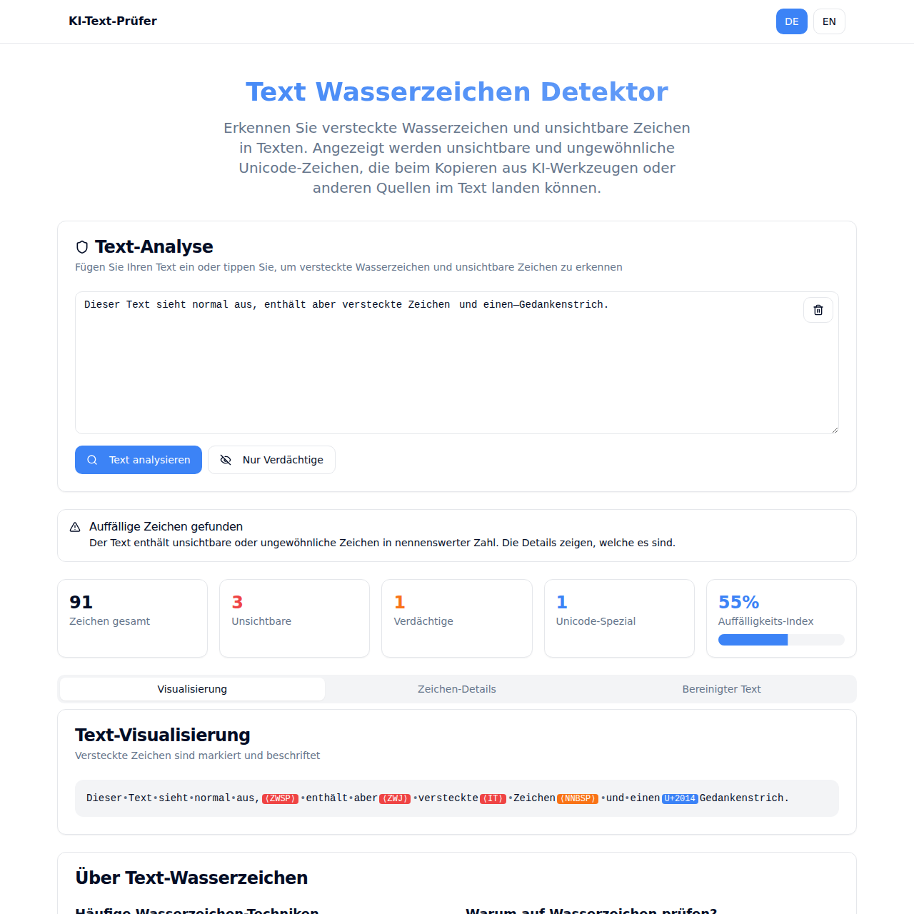

# KI-Text-Prüfer

KI-Text-Prüfer (German for "AI text checker") is a small web app that finds invisible and unusual Unicode characters in text: zero-width characters, variation selectors, invisible math operators, special spaces, directional marks and a few typographic characters. Such characters do not show up on screen, so they are easy to overlook when text is copied between tools.

The app highlights each finding in a visualization, lists the characters with their code points and offers a cleaned copy of the text and a JSON report.



**Live demo:** https://withus.github.io/ki-text-pruefer/ (the link is active once the repository is published and GitHub Pages is set to deploy from GitHub Actions)

The app reports which characters are present. It does not decide whether a text was written by an AI, and finding one of these characters is not proof of that. The percentage in the score tile ("Auffälligkeits-Index" in the German view, "Flagged character score" in the English view) is a rough score based on the share of flagged characters (see below), not a probability. The code and the JSON report still name the value `watermarkLikelihood`.

## Why this exists

The tool started in September 2025 as a page on the author's own website. In 2026 it was moved out into this standalone repository. The website's navigation, footer and SEO components were replaced by a minimal shell (header with a DE/EN switch, footer with a link to this repository). The two tool components under `src/pages/Tools/` are otherwise the original code. The changes to them:

- One padding class in the German view that had made room for the old fixed navigation bar.
- Emoji removed from the six alert titles.
- In the English view, a broken replacement character (U+FFFD) in the character visualization replaced by the code point, for example `[U+200B]`.
- More neutral wording instead of unsupported claims about AI tools: the alert titles and descriptions, the character descriptions, the sub-heading, the list entries about AI and privacy, and the label of the score tile ("Auffälligkeits-Index" and "Flagged character score" instead of "Wasserzeichen" and "Watermark Likelihood").
- Two entries removed from the technique list of the English view (homoglyphs and whitespace patterns), because that view detects neither.
- The description of the cleaned text now states what the cleaning does, and the German technique list describes dashes and quotation marks as ordinary typography.
- The paste problem in the English view is fixed (see below).
- A leftover remark in a code comment of the German view was removed.

The detection logic is unchanged: `getCharacterInfo`, the classification, the score formula and the cleaning work as before.

## What it detects

The German view (`src/pages/Tools/WatermarkDetectorDE.tsx`) is the default and the more complete one. The English view (`src/pages/Tools/WatermarkDetector.tsx`) is a separate component with a shorter list. Both classify characters in a `getCharacterInfo` function.

| Class in the UI | Code points | German view | English view |
| --- | --- | --- | --- |
| Invisible (red) | U+200B, U+200C, U+200D, U+FEFF, U+2060, U+180E | lines 57 to 104 | lines 87 to 118 |
| Invisible (red) | U+2061 to U+2064 (invisible math operators) | lines 107 to 134 | not detected |
| Invisible (red) | U+00AD (soft hyphen) | line 170 | not detected |
| Invisible (red) | U+FE00 to U+FE0F (variation selectors) | line 202 | not detected |
| Suspicious (orange) | U+2000 to U+200A, U+202F, U+205F, U+3000 (special spaces) | lines 137 to 150 | not detected |
| Suspicious (orange) | U+200E, U+200F, U+202A to U+202E (directional marks) | lines 153 to 159 | lines 136 to 149 |
| Suspicious (orange) | U+2066 to U+2069 (directional isolates) | lines 160 to 163 | not detected |
| Suspicious (orange) | U+2028, U+2029 (line and paragraph separator) | lines 166 to 167 | not detected |
| Unicode special (blue) | U+2013, U+2014 (en and em dash), counted towards the score | lines 173 to 174 | not detected |
| Unicode special (blue) | curly quotes U+2018, U+2019, U+201C, U+201D, U+201E, bullet U+2022, ellipsis U+2026, no-break space U+00A0, any other non-ASCII character outside the Latin letter list | lines 175 to 181, 186, 217 | not detected, except U+00A0, which is listed as whitespace (line 122) |

Plain spaces, tabs, line breaks and other control characters get their own classes in both views (German view lines 184 to 199, English view lines 121 to 133).

Two things to know about the English view. First, the array `watermarkPatterns` (lines 54 to 79) also lists U+2061 to U+2064 and U+FE00 to U+FE0F, but nothing reads that array, so those characters are not flagged. Second, the English view analyzes when you press the analyze button and when you paste text, but not while you type. The paste handler (lines 214 to 217) only sets a flag, and an effect (lines 207 to 212) runs the analysis once the pasted text has reached the component state. Previously the handler started the analysis right away with the text from before the paste. If a paste leaves the text unchanged (for example an empty clipboard), the flag stays set and the analysis runs at the next change instead. The German view analyzes while you type.

### How the output is built

- **Cleaned text, German view** (`analyzeText`, from line 230): letters, digits and punctuation in ASCII, whitespace and the Latin letters listed at line 211 are kept. En and em dashes become `-`, curly quotes become straight quotes. Invisible, suspicious and control characters are dropped, and so is every other non-ASCII character, for example the euro sign, emoji, the ellipsis and the no-break space.
- **Cleaned text, English view** (`analyzeText`, from line 155): only characters classified as invisible or suspicious are removed. Everything else stays as it is.
- **Score** (the tile "Auffälligkeits-Index" in the German view, "Flagged character score" in the English view): the number of flagged characters divided by the text length, multiplied by 1000 in the German view (line 307) and by 500 in the English view (line 192), rounded and capped at 100. It grows quickly with a few findings and says nothing beyond "how much of this text is flagged".
- **Characters outside the Basic Multilingual Plane** (emoji, Unicode tag characters in the U+E0000 range) are not identified individually. The German view reads only the first UTF-16 unit of such a character, lists it as "Unicode Character" with a surrogate value such as U+D83D and drops it from the cleaned text. The English view splits the text into UTF-16 units and treats both halves as normal characters.
- **Variation selectors** also occur in ordinary emoji text, so the German view flags those as invisible as well.

## Privacy: everything runs in the browser

The text you enter is processed in the page and is not sent anywhere. The application source contains no `fetch`, `XMLHttpRequest`, `sendBeacon`, `WebSocket` or `EventSource` call:

```sh
grep -rnE "fetch\(|XMLHttpRequest|sendBeacon|WebSocket|EventSource" src
```

The only browser APIs that move data out of the analysis are the copy button (`navigator.clipboard.writeText`, German view line 348, English view line 220) and the report download, which builds a local `Blob` (German view line 361, English view line 232). There is no analytics, no cookie or storage access (`document.cookie`, `localStorage`, `sessionStorage` do not appear in `src`), and no external fonts or scripts are loaded. You can confirm this in the network tab of your browser: after the page has loaded, entering or pasting text causes no further requests.

The production bundle contains one `fetch` call from Vite's module preload helper. It only requests the app's own asset links.

## Run locally

Node.js 22 is what the CI workflow uses and what the project was built with.

```sh
npm ci
npm run dev       # dev server, served under /ki-text-pruefer/ (for example http://localhost:5173/ki-text-pruefer/)
npm run build     # production build into dist/
npm run preview   # serve the production build locally
```

## Deployment

Every push to `main` runs `.github/workflows/deploy.yml`, which builds the app and publishes `dist/` to GitHub Pages. In the repository settings, set Pages to "GitHub Actions" as the source. The site is served from a subpath, so `vite.config.ts` sets `base: '/ki-text-pruefer/'`. If you rename the repository, change that value as well.

## Stack

Vite, React 18, TypeScript, Tailwind CSS 3, shadcn/ui components (Radix UI) and lucide-react icons. Only the seven UI components the tool uses are included (alert, badge, button, card, progress, tabs, textarea).

## License

MIT, see [LICENSE](LICENSE). Copyright (c) 2025 Sven Withus.
